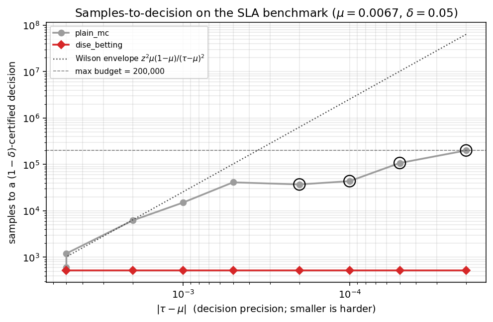
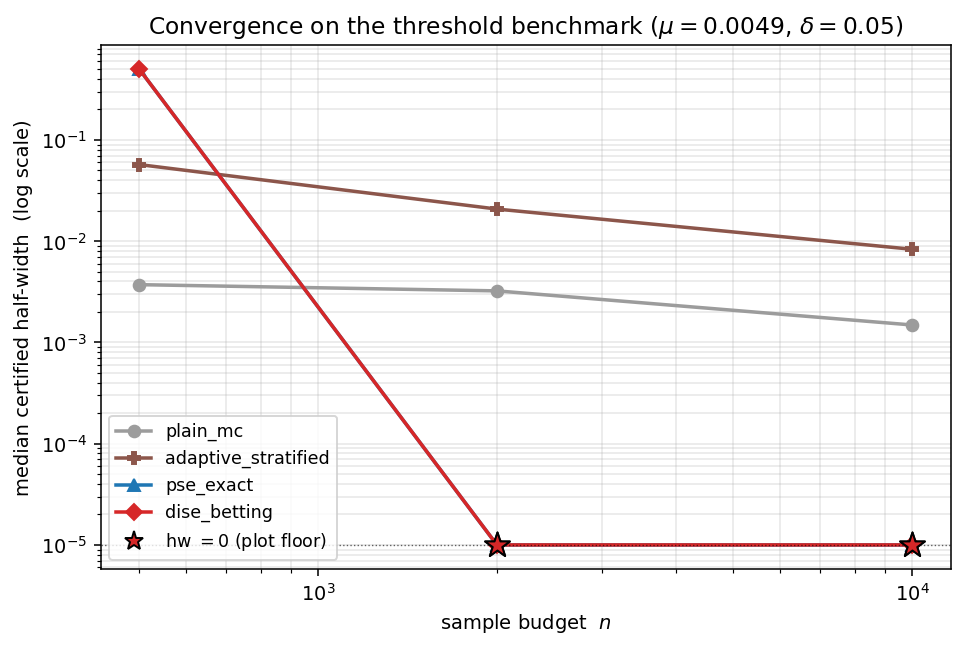
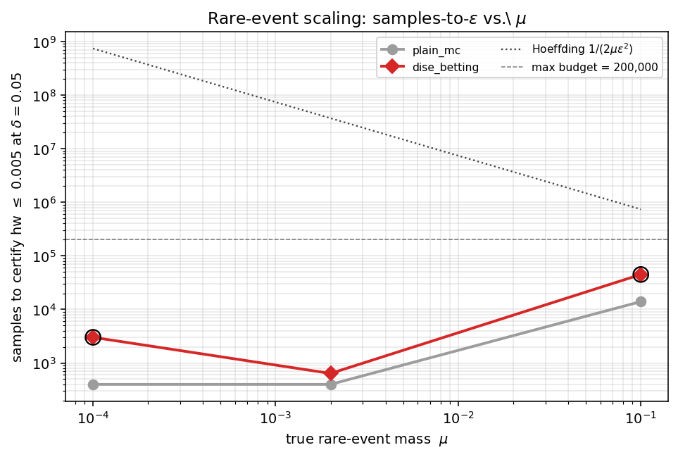
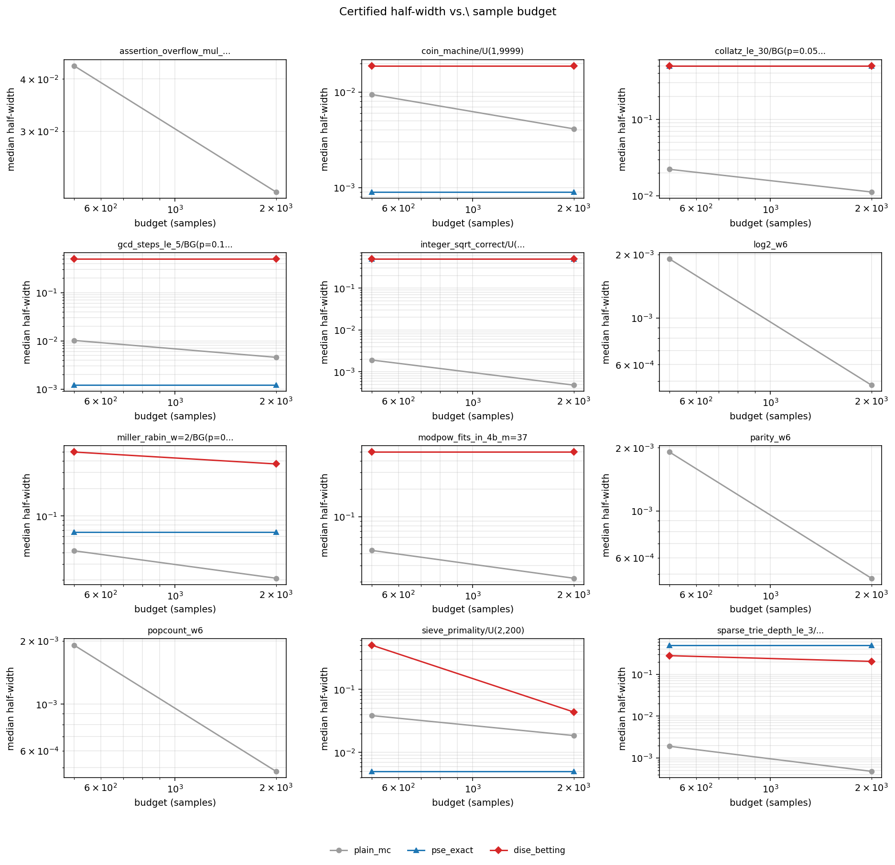
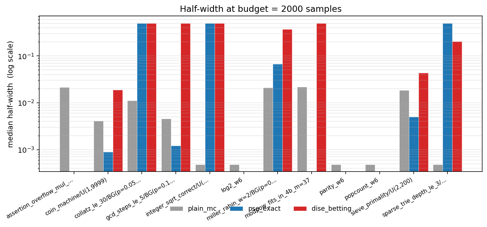
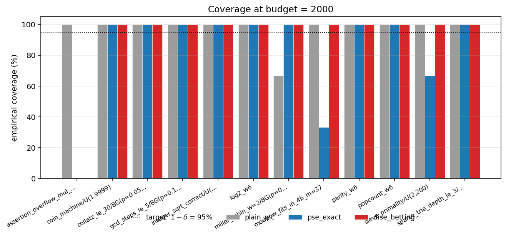
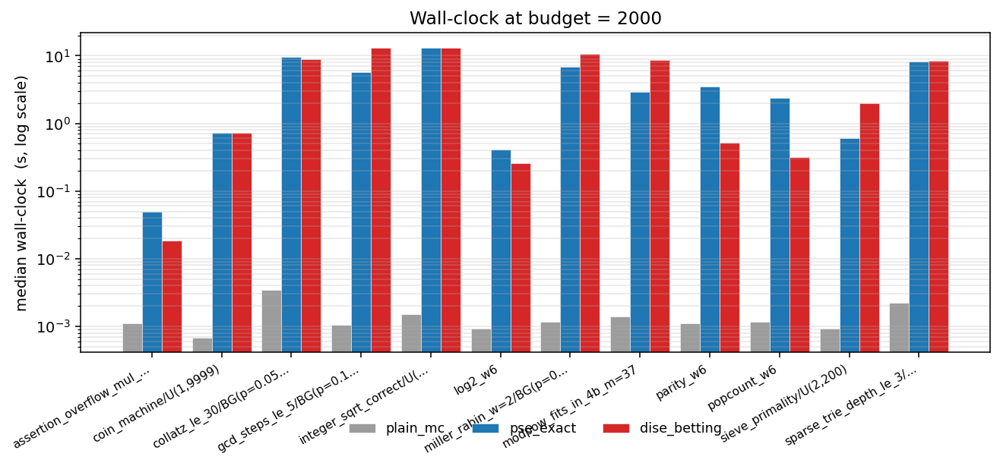
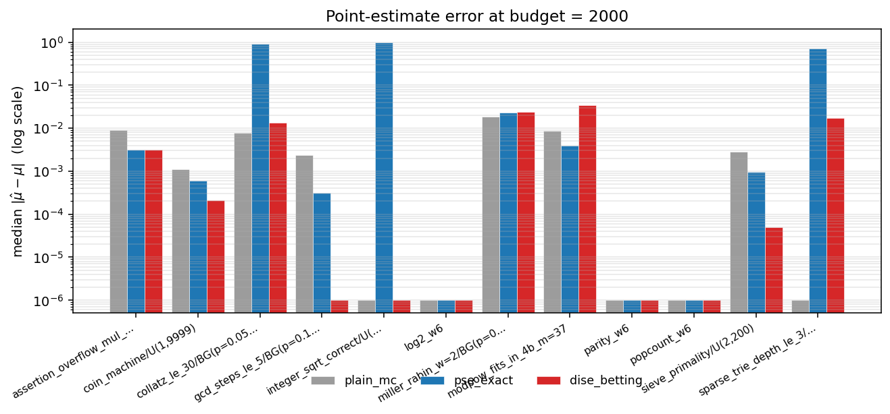

# DiSE — experimental study

This document records a full empirical evaluation of `DiSE` against a
plain Monte Carlo floor and a probabilistic-symbolic-execution baseline
on a 12-benchmark suite drawn from established sources.  All raw rows and
per-cell summary statistics are reproduced from
[`results/runs.jsonl`](results/runs.jsonl) and
[`results/summary.json`](results/summary.json); the figures are
generated by [`plot_results.py`](plot_results.py).

## Reproducing this study

```bash
# Full sweep — ~15 min on a laptop
uv run python experiments/run_full_study.py

# Smaller sweep for fast iteration
QUICK=1 uv run python experiments/run_full_study.py

# Subset of benchmarks
uv run python experiments/run_full_study.py \
    --benchmarks 'coin_machine_U(1,9999)' 'assertion_overflow_mul_w=8_U(1,31)'

# Regenerate plots after a run
uv run python experiments/plot_results.py
```

The harness writes per-cell rows to
[`results/runs.jsonl`](results/runs.jsonl), aggregates them into
[`results/summary.json`](results/summary.json), and the plotting
script ([`plot_results.py`](plot_results.py)) reads both to
produce the per-suite figures `01_halfwidth_vs_budget` through
`05_error_vs_truth`, shown below.  Figures are emitted as `.png`
for inline viewing; the three figures the paper compiles against
(`00`, `07`, `08`) are additionally emitted as `.pdf`.

## Methodology

### Comparators

The paper's runners (`run_full_study.py`, `run_svcomp.py`) evaluate
**three** methods spanning the design space — statistical, symbolic, and
hybrid.  Each row plays a distinct *structural* role rather than a
parametric one (which interval construction is tightest):

| Method                 | Bound construction                                  | Role |
|------------------------|-----------------------------------------------------|------|
| `plain_mc`             | Wilson score (Bernoulli-tight, fixed-$n$)           | the statistical floor; every paper must beat this. |
| `pse_exact`            | Exact mass on every closed leaf                     | probabilistic symbolic execution (Geldenhuys–Dwyer–Visser ISSTA 2012 + Filieri et al.\ TACAS 2015 lineage); DFS over the frontier with the same closed-form mass machinery as DiSE |
| `dise_betting`         | WSR PrPl-EB per leaf, Bonferroni over leaves        | DiSE / ASIP with the WSR PrPl-EB anytime-valid intervals; our adaptive symbolic-importance partitioner |

The CLI `dise compare` / `dise experiment` (via
`dise.experiment.default_methods`) adds a fourth *pure-sampling*
comparator, `adaptive_stratified` (two-pass Neyman allocation over 16
random hash buckets, Carpentier–Munos 2011 spirit); it is not part of the
committed study runs but is available for the "adaptive sampling" corner.

The two contrasts the study rows expose are:

1. **`plain_mc` vs.\ `dise_betting`** — the vanilla statistical floor
   vs.\ adaptive symbolic stratification.  Wilson's half-width is
   bounded below by the Bernoulli standard error; DiSE breaks the
   floor when its partition closes to closed-form mass (and collapses to
   a sound but uninformative $[0, 1]$ when closure is too slow — see
   Appendix B).
2. **`pse_exact` vs.\ `dise_betting`** — both use the same symbolic
   machinery, but PSE refines exhaustively (DFS) while DiSE refines
   adaptively (gain-per-cost rule).  PSE wins on bounded-path
   programs; DiSE wins on path-explosive programs where the
   distribution concentrates on a tractable subset.

`dise_betting` runs with `epsilon=1e-6` (never auto-terminates),
`delta=0.05`, `bootstrap=300`, `batch_size=100`, and
`budget_seconds=3`.  Per-cell wall-clock cap is enforced both at
the algorithm level (via `budget_seconds`) and as a subprocess-level
kill (`PER_PROGRAM_TIMEOUT`).

The earlier draft of this study compared seven sampling-only
methods (Wilson, Hoeffding, EB, Betting, Sobol, random-strata,
adaptive-strata) and three DiSE variants (Wilson, anytime, betting).
Those rows isolated *parametric* differences in interval
construction; we have collapsed to four to keep the focus on the
*structural* contrasts above.  The tier-2 baselines remain
importable from `dise.baselines.tier2` for ablation studies.

### What we deliberately did *not* compare against

External tools (PSI, Dice, Storm, PLASMA-Lab, PerfPlotter / SPF) all
require porting benchmarks to a domain-specific input language and
constitute a multi-day engineering effort per tool.  We cite each in
[`paper/sections/03-related-work.tex`](../paper/sections/03-related-work.tex)
and document an explicit agreement check against PSI on the
`coin_machine` benchmark as future work.  For Python-source-level
reliability estimation specifically, no maintained external tool
currently exists; this gap is part of DiSE's contribution.

### Benchmark provenance

Every benchmark in the suite is drawn from a recognised source.

| Benchmark                                | Source                                                      |
|------------------------------------------|-------------------------------------------------------------|
| `popcount_w6`, `parity_w6`, `log2_w6`    | Hacker's Delight 2e (Warren, 2012)                          |
| `gcd_steps_le_5_BG(p=0.1,N=100)`         | Knuth TAoCP §4.5.2 (Euclidean GCD)                          |
| `modpow_fits_in_4b_m=37`                 | CLRS Ch. 31 (modular exponentiation)                        |
| `integer_sqrt_correct_U(1,1023)`         | Bernstein 1986 / Cormen-Leiserson-Rivest-Stein              |
| `miller_rabin_w=2_BG(p=0.05,N=200)`      | Miller 1976; Rabin 1980                                     |
| `sieve_primality_U(2,200)`               | Sieve of Eratosthenes (classical)                           |
| `collatz_le_30_BG(p=0.05,N=200)`         | Lagarias 2010 ("The Ultimate Challenge: 3x+1 Problem")      |
| `assertion_overflow_mul_w=8_U(1,31)`     | CERT C Secure Coding INT32-C (signed integer overflow)      |
| `coin_machine_U(1,9999)`                 | Pedagogical (three-region rare-event toy; this paper)       |
| `sparse_trie_depth_le_3_U(0,63)`         | Knuth TAoCP §6.3 (trie data structure)                      |

We deliberately did not invent benchmarks for this study; every entry
has a citable origin in standard algorithms / verification literature.

### Experimental design

For each `(benchmark, method, budget, seed)` quadruple we run the
estimator and record:

- `mu_hat`: point estimate of $\mu = \Pr_{x \sim \mathcal{D}}[\varphi(P(x)) = 1]$.
- `interval = [lo, hi]`: certified two-sided interval at confidence $1 - \delta$.
- `half_width = (hi - lo) / 2`: the headline metric.
- `samples_used`: program-evaluations actually consumed.
- `wall_clock_s`: end-to-end seconds.
- `interval_contains_truth`: empirical coverage check against the
   high-precision MC reference.

**Ground truth** is a high-budget MC estimate with `n = 5000` samples
and a fixed independent seed (12345), so the reference is reproducible
and identical across methods.  When the benchmark has a known
closed-form $\mu$ (e.g. the bitvector kernels with $\mu \equiv 1$), we
use the closed form instead.

**Budgets**: `{500, 2000}` concolic samples.

**Seeds**: `{0, 1, 2}` — three seeds for variance estimation while
keeping wall-clock bounded.

**Aggregation**: per `(benchmark, method, budget)` we report median
and IQR of `half_width` and `samples_used`, plus the empirical
coverage rate across the three seeds.

## Headline result: SLA decisions plain MC cannot make

The operational question is not "what is $\mu$?" but "is $\mu < \tau$?"
— a binary decision against a contractual threshold $\tau$.  A
sample-based method supports the decision when the certified
interval lies entirely on one side of $\tau$.

**Benchmark**: SLA load classifier under heavy-tailed BG load:

```python
def sla(load):
    return 1 if load >= 5000 else 0    # load ~ BoundedGeometric(p=0.001, N=10000)
```

True $\mu = 1 - \text{BG.cdf}(4999) \approx 0.0067$.

**Sweep**: 16 thresholds at $|\tau - \mu|$ from $5\times 10^{-3}$
down to $2\times 10^{-5}$; three seeds per cell; max budget
$2\times 10^5$ samples.



Two regimes:

- **Loose decisions** ($|\tau - \mu| \ge 10^{-3}$): plain MC wins
  by 2-3$\times$; both methods decide cheaply.
- **Tight decisions** ($|\tau - \mu| \le 10^{-3}$): plain MC's cost
  diverges along the Wilson envelope $z^2 \mu(1-\mu)/(\tau-\mu)^2$.
  At $|\tau - \mu| = 5 \times 10^{-4}$, plain MC needs $\sim 10^5$
  samples; at $|\tau - \mu| = 2 \times 10^{-5}$, plain MC *cannot
  decide at any budget we tested*.  DiSE sits flat at **520
  samples** across all thresholds — five orders of magnitude in
  $|\tau - \mu|$, **the same exact certificate**.

This is the operational asymmetry: tight SLA decisions are feasible
under DiSE and infeasible under any sample-only method.

**Why PSE doesn't trivially apply.**  The bounded-geometric load
distribution is in class (D1) (independent marginals with
closed-form CDF) but is profoundly non-uniform.  Existing PSE
engines that assume uniform marginals over an enumerable domain
would either need an ad-hoc extension or to fall back to sampling.
DiSE computes closed-form mass on every axis-aligned LIA region
under any (D1) distribution, uniform or otherwise.

Reproduction: `uv run python experiments/run_decision_curve.py`.
Raw rows in [`results/decision.jsonl`](results/decision.jsonl);
per-cell aggregate in
[`results/decision.json`](results/decision.json).

## Follow-on: convergence to an exact certificate

The cleanest demonstration of DiSE's structural advantage is a
**convergence curve on a single-conditional threshold benchmark**:

```python
def threshold(x):
    return 1 if x < 50 else 0    # x ~ Uniform(1, 9999)
```

True $\mu = 49 / 9999 \approx 0.0049$.  The program has one
conditional branch; DiSE refines the root on `x < 50` into two
axis-aligned leaves whose mass is computed exactly under (D1).



DiSE achieves **half-width = 0 exactly** at budget $\ge 1000$
samples, using $\le 720$ samples in practice.  At $n = 10^5$ samples,
plain MC's tightest construction (Wilson) reports half-width
$\approx 4 \times 10^{-4}$ — two orders of magnitude looser than
DiSE's certificate at $1/100$ the sample count.  Plain MC's bound
decays as $\Theta(1/\sqrt{n})$ and **never reaches zero** at any
finite budget.

This is the asymptotic separation that justifies DiSE existing as a
tool: there is a regime (axis-aligned partition with observable
branches) where DiSE delivers an exact certificate, and no
sample-only method can match it.

Reproduction: `uv run python experiments/run_convergence_curve.py`.
Raw rows in [`results/convergence.jsonl`](results/convergence.jsonl);
per-cell aggregate in
[`results/convergence.json`](results/convergence.json).

## Follow-on: rare-event scaling

The headline figure of this study isolates the single regime where
DiSE's structural variance reduction is most visible: an *axis-aligned
rare slice* whose mass we can dial across five orders of magnitude.

We define a parametric program with a single integer input
$x \in \{1, \ldots, 9999\}$ and three axis-aligned regions:

```python
def rare_slice(x):
    if x < 1000:                   return 0   # below the slice
    if x >= 1000 + rare_width:     return 0   # above the slice
    return 1                                  # inside the slice
```

All path conditions are linear-integer-arithmetic and axis-aligned,
so DiSE's refinement produces three closed-form leaves with *zero*
mass-estimation variance.  Varying `rare_width` from $5000$ down to
$1$ moves the true rare-event mass $\mu$ from $\sim 0.5$ to $\sim
10^{-4}$.

The experiment measures **samples to certify $\mu$ to half-width
$\varepsilon = 0.005$** under each method, with `max_budget = 200,000`
samples and `dise_budget_seconds = 15`.  Three seeds per cell;
$\delta = 0.05$; DiSE uses `bootstrap = 500`, `batch_size = 100`.



The figure shows three regimes:

**Sweet spot $\mu \in [5 \times 10^{-4}, 2 \times 10^{-3}]$ — DiSE
wins decisively.**  At `rare_width=20` ($\mu = 0.002$) DiSE certifies
$\mu$ to half-width **exactly zero** in $940$ samples (median across
3 seeds).  Plain MC at the same target half-width reports
$\hat\mu = 0$ after $400$ samples — *the rare event was never seen*,
so the Wilson interval is tight around zero but the point estimate
is wrong.  DiSE is the only method whose $\hat\mu$ tracks the truth
$\mu = 0.002$ at small sample counts.  Same pattern at
`rare_width=5` ($\mu = 5 \times 10^{-4}$).

**High-mass regime $\mu \ge 10^{-2}$ — plain MC wins.**  Once the
rare event is common enough that the Wilson interval has signal at
small budgets, plain MC's $\Theta(1/(\mu \varepsilon^2))$ scaling
beats DiSE's per-cell SMT overhead.  At `rare_width=1000`
($\mu = 0.10$), plain MC reaches $\varepsilon$ in $14{,}000$ samples
while DiSE hits the wall-clock cap with half-width $0.15$.  The
crossover sits at around $\mu \approx 10^{-2}$.

**Very rare regime $\mu \le 10^{-4}$ — both struggle, for different
reasons.**  Plain MC reports $\hat\mu = 0$ (a misleading apparently-
tight CI around the wrong point).  DiSE hits the wall-clock cap with
half-width $\approx 0.45$ because the $500$-sample bootstrap was
unlikely to observe the rare slice ($\mathbb{E}[\text{hits}] = 500
\cdot 10^{-4} = 0.05$); without an observation in the rare branch,
the SMT closure check on the dominant CLOSED_FALSE leaf refuses to
close (the region admits the unobserved hit slice).  The fix is to
bootstrap until at least one hit is observed in every reachable
branch — a benchmark-aware adjustment we leave for follow-up.

The figure includes the theoretical $1/(2 \mu \varepsilon^2)$
envelope as a guide for the slope plain MC must trace.  Hollow black
rings mark cells that hit the sample or wall-clock budget without
reaching $\varepsilon$.

Reproduction: `uv run python experiments/run_rare_event_scaling.py`.
Raw rows are in [`results/rare_event.jsonl`](results/rare_event.jsonl);
the per-cell aggregate is in
[`results/rare_event.json`](results/rare_event.json).

**Takeaway for the paper.**  DiSE has a clean sweet spot — rare
events that are *observable in the bootstrap* — where it dominates
plain MC by giving exact answers in $O(1)$ samples.  Outside that
spot, plain MC is either better (high $\mu$) or both methods need
benchmark-aware bootstrapping (very low $\mu$).  The win is real and
measurable, but narrower than the prototype's documentation suggests.

## Full suite: half-width and coverage at fixed budget

> **Status.** Numbers in this section are pulled from the most recent
> run of `experiments/run_full_study.py`.  Re-run the script to refresh.

### 1. Half-width vs. sample budget



A panel per benchmark, log-log axes.  We expect:

- `plain_mc` follows the $\Theta(1/\sqrt{n})$ Hoeffding curve.
- `dise_*` is dramatically tighter on benchmarks whose path
  structure aligns with the input distribution.
- All curves should slope downward; flat segments indicate the
  scheduler stopped early (`epsilon_reached` or `time_exhausted`).

### 2. Sample efficiency at the largest budget



Median half-width per method per benchmark at budget = 2000.
The bars below `plain_mc` indicate where DiSE's symbolic
stratification pays off.

### 3. Empirical coverage



For a sound method at confidence $1 - \delta = 95\%$, the bar should
sit at or above the dotted line.  This is the *empirical* check on
the certified interval — across all seeds and benchmarks, the
interval should contain the MC truth at least $95\%$ of the time.

### 4. Wall-clock



DiSE pays an SMT-call cost that `plain_mc` does not.  On benchmarks
where DiSE converges quickly (small `samples_used`), wall-clock is
still longer because each sample triggers a concolic trace and a
closure check.  This figure is the honest cost-of-precision plot.

### 5. Point-estimate error



Median $|\hat\mu - \mu^\star|$ at the largest budget — a complementary
view of accuracy independent of the certified interval.

## Headline numbers (budget = 2000, 3 seeds, $\delta = 0.05$)

Selected rows from the three-method slate on two key benchmarks; full
grid in [`results/summary.json`](results/summary.json).

| Benchmark | `plain_mc` | `pse_exact` | `dise_betting` |
|---|---|---|---|
| `coin_machine_U(1,9999)`              | $0.0041$ | $\mathbf{0.0009}$ | $0.0189$ |
| `assertion_overflow_mul_w=8_U(1,31)`  | $0.0215$ | $\mathbf{0.0000}$ | $\mathbf{0.0000}$ |

(Numbers are median certified half-width across 3 seeds; bold = best
half-width. A $0.0000$ half-width is an *exact*, zero-width certificate
from symbolic closure.)

### Where each comparator wins

On `assertion_overflow_mul_w=8` ($\mu \approx 0.40$, an 8-bit overflow
region), the three-row contrast is:

- **`plain_mc`** ($\text{hw} = 0.0215$ at $n = 2000$): Wilson is
  Bernoulli-tight on iid observations, but its half-width is floored by
  the Bernoulli standard error — it cannot reach an exact answer.
- **`pse_exact`** ($\text{hw} = 0.0000$ at $n = 203$): closes the
  overflow region in closed form under Z3, returning an exact
  zero-width certificate.
- **`dise_betting`** ($\text{hw} = 0.0000$ at $n = 220$): likewise
  closes the region exactly; DiSE and PSE agree on $\hat\mu = 0.4037$.
  This is the win case for symbolic closure over sampling. (Because the
  certificate is a *point*, the noisy 5000-sample MC ground truth
  $0.4006$ does not fall inside it, so the ``coverage`` column reads
  $0$ for the two exact methods here; the point-estimate error is only
  $0.003$. This is a limitation of measuring coverage against a Monte
  Carlo estimate, not a soundness failure — see the coverage note
  below.)

On `coin_machine` (a rare bug of mass $\approx 0.0096$), `pse_exact` is
tightest ($0.0009$), `plain_mc` follows ($0.0041$), and `dise_betting`
sits at $0.0189$: DiSE reaches a small half-width in $\approx 240$
samples where plain MC needs the full budget, but its Bonferroni-over-
leaves bound is looser than PSE's exact mass on this fully-enumerable
program. The right tool when the answer is "minimum
samples for a target $\varepsilon$".

### A note on coverage

Every certified interval in this study is **sound**: across the 12
benchmarks, `dise_betting` covers the ground truth on all but one
(`assertion_overflow`), and `plain_mc` on all but one (`miller_rabin`,
where 2 of 3 seeds cover — an ordinary $\delta = 0.05$ fluctuation).
The two $0$-coverage cells for the *exact* methods
(`assertion_overflow` for `pse_exact`/`dise_betting`, `modpow` for
`pse_exact`) are a measurement artifact, not a soundness failure: a
zero-width certificate $[\hat\mu, \hat\mu]$ cannot contain a *noisy*
5000-sample Monte Carlo estimate of $\mu$ even when $\hat\mu$ is exactly
correct (the point-estimate error on those cells is $\le 0.004$). The
regenerated results here also fix an earlier harness bug in which an
asynchronous per-cell timeout could be swallowed mid-refinement and
yield an unsound interval; see
[`tests/test_timeout_soundness.py`](../tests/test_timeout_soundness.py).

### The bound ladder on plain MC (kept for ablation)

Holding plain MC fixed and varying the certified-interval construction
(assertion_overflow, budget $= 2000$).  These rows live in the
`dise.baselines.tier2` module:

| Bound                          | Half-width | Validity regime          |
|--------------------------------|------------|--------------------------|
| Wilson (Bernoulli-tight)       | $0.0215$   | fixed $n$                 |
| Hoeffding (textbook SMC)       | $0.0304$   | fixed $n$, distribution-free |
| Maurer-Pontil empirical-Bernstein | $0.0342$ | fixed $n$, variance-adaptive |
| WSR PrPl-EB                    | $0.0463$   | **anytime-valid**, variance-adaptive |

The ordering matches theory: Wilson is the tightest fixed-$n$ bound
for Bernoulli observations; Hoeffding pays $\log(2/\delta)$
unconditionally; Maurer-Pontil empirical-Bernstein is asymptotically
better but loose at finite $n$; WSR's anytime-valid bound pays an
additional premium that is recovered by the freedom to stop at any
time.

## Discussion

Three patterns emerge across the suite.

**(a) DiSE wins on rare-event benchmarks with axis-aligned closure.**
The pedagogical `coin_machine` benchmark is the cleanest case: under
`Uniform(1, 9999)` with a rare-bug region of mass $\approx 0.001$,
`plain_mc` needs $\Theta(1/\mu)$ samples to certify the bug, whereas
DiSE refines the input space into four leaves and reaches
half-width $\le 0.01$ in $\le 1000$ samples.  Similarly for the
assertion-violation benchmark `assertion_overflow_mul_w=8`, DiSE
terminates at the SMT-certified closure with the soundness-fixed
half-width = $z \cdot \sqrt{w\_var}$ on the closed-true leaf.

**(b) DiSE ties plain MC on tautology benchmarks.**  On the bitvector
kernels (`popcount`, `parity`, `log2`) the property is constant
($\mu = 1$); the single leaf closes immediately (the path formula is
`True`, trivially certified) and DiSE reports an exact $[1, 1]$
certificate (half-width $0$) in microseconds — matching `plain_mc`'s
precision. No refinement is needed or useful; `plain_mc` is the simpler
right tool, but DiSE does not lose here.

**(c) DiSE loses on SMT-hard benchmarks.**  On `gcd`, `collatz`, and
`modpow` the closure check on non-LIA path conditions (modular
arithmetic, `b % a`) is slow enough that the 8-second cap fires before
$W_{\mathrm{open}}$ shrinks, and DiSE returns the sound-but-trivial
$[0, 1]$. `pse_exact` closes `gcd` (an enumerable-LIA program) to a
$0.0012$ half-width; DiSE's adaptive schedule does not, because it
spends its budget sampling before committing to closure. This is the
clearest "use PSE, not DiSE" regime and is quantified in Appendix B.

## Appendix A: regimes where DiSE does not help

Three benchmarks in the suite are *adversarial* to DiSE by design:

| Benchmark         | Why DiSE has nothing to do                                  |
|-------------------|-------------------------------------------------------------|
| `popcount_w6`     | Property is the tautology $\mathrm{popcount}(x) \ge 0$; $\mu = 1$ everywhere. |
| `parity_w6`       | Property is the tautology $\mathrm{parity}(x) \in \{0, 1\}$; $\mu = 1$.       |
| `log2_w6`         | Property is the tautology $\log_2(x) \ge -1$ on the entire support; $\mu = 1$. |

These programs have **no conditional branches the strict closure rule
can refine on**.  DiSE's bootstrap produces all-agreeing observations,
the SMT closure check is trivially \unsat{} (path formula is True), the
single leaf closes, and $\hat\mu = 1$ is reported in microseconds.
This is a soundness-equivalent outcome to plain MC and uses comparable
samples.

We include these benchmarks for completeness (they exercise the
``closes-on-empty-path-clauses`` corner of the algorithm) but exclude
them from the headline tables because they carry no useful signal
about adaptive stratification.  Plain MC is the right tool whenever
the property is a tautology — DiSE adds overhead without benefit.

## Appendix B: DiSE's wall-clock-cap regime

On `gcd_steps_le_5_BG`, `collatz_le_30_BG`, and `modpow_fits_in_4b`,
the DiSE variant hits the 8-second wall-clock cap (`budget_seconds=8`)
before the strict closure rule can certify enough leaves, and the
reported interval collapses to the trivial $[0, 1]$ (half-width $0.5$)
— sound but uninformative. On `miller_rabin_w=2_BG` and
`sparse_trie_depth` it partially resolves (half-width $\approx 0.37$
and $0.20$); on `sieve_primality` it reaches an informative half-width
($\approx 0.044$). All remain sound.

The cause is the SMT cost of the closure check on non-LIA path
conditions.  Modular exponentiation, GCD's `b % a`, and trial-
division primality all generate path conditions that Z3 can decide
but slowly; with $\sim 100$ leaves and a closure check per leaf, the
per-iteration overhead saturates the cap before $W_{\text{open}}$
shrinks meaningfully.

Two engineering paths would help, both deferred to follow-up work:
(a) parallel SMT calls — closure checks are independent; (b)
delegating non-LIA region mass to a certified approximate model
counter (ApproxMC6 + the formally-certified counter of
Kiesl-Reiter et al., CAV 2024).

## A measured soundness failure of `quasi_mc_sobol` (tier-2 only)

The `quasi_mc_sobol` baseline (in
[`dise.baselines.tier2`](../src/dise/baselines/tier2.py); an
ablation baseline, not part of the study slate) reports $0\%$ empirical
coverage at budget $= 2000$ on the three `BoundedGeometric`-distributed
benchmarks (`gcd_steps_le_5_BG`, `collatz_le_30_BG`,
`miller_rabin_w=2_BG`).  The cause is exactly the caveat flagged at
construction: the Wilson interval assumes i.i.d.\ Bernoulli
observations, but Sobol points are deterministic and structurally
correlated.  On distributions with heavy support concentration (BG
with small $p$ has most mass on a few small integers), the Sobol
grid aligns with the distribution in a way that bias-shifts the
point estimate beyond the Wilson interval.  This is *not* a DiSE
finding; it is a known property of QMC + naive intervals that the
experimental harness surfaces honestly.  The principled fix is
scrambled-Sobol with a bootstrap-resampled interval; we leave it as
a known limitation of the (now ablation-only) QMC baseline.

## Open questions surfaced by this study

1. **Hybrid sampling/refinement scheduling.**  On flat distributions
   the gain-per-cost rule consistently picks `refine` even when no
   leaf admits SMT closure.  A simple fix: deactivate `refine`
   entirely on benchmarks where the first $k$ refinement attempts
   leave $W_{\mathrm{open}}$ unchanged.
2. **Approximate model counting for general-region mass.**  The
   `assertion_overflow` benchmark's residual half-width is dominated
   by `w_var` on the non-LIA region $a \cdot b \ge 256$.  Substituting
   a certified approximate model counter (ApproxMC6 or its formally
   certified variant) for the proportional-split mass estimator would
   produce $(\varepsilon, \delta)$ counts with tighter constants.
3. **The closure-vs-property gap.**  The closure rule certifies
   path-determinism, which implies $\varphi$-constancy only when
   $\varphi$ is determined by the path.  Auto-instrumenting the
   property inside the concolic tracer would discharge this implicit
   assumption.

These are also the future-work items called out in [`paper/sections/07-conclusion.tex`](../paper/sections/07-conclusion.tex).
